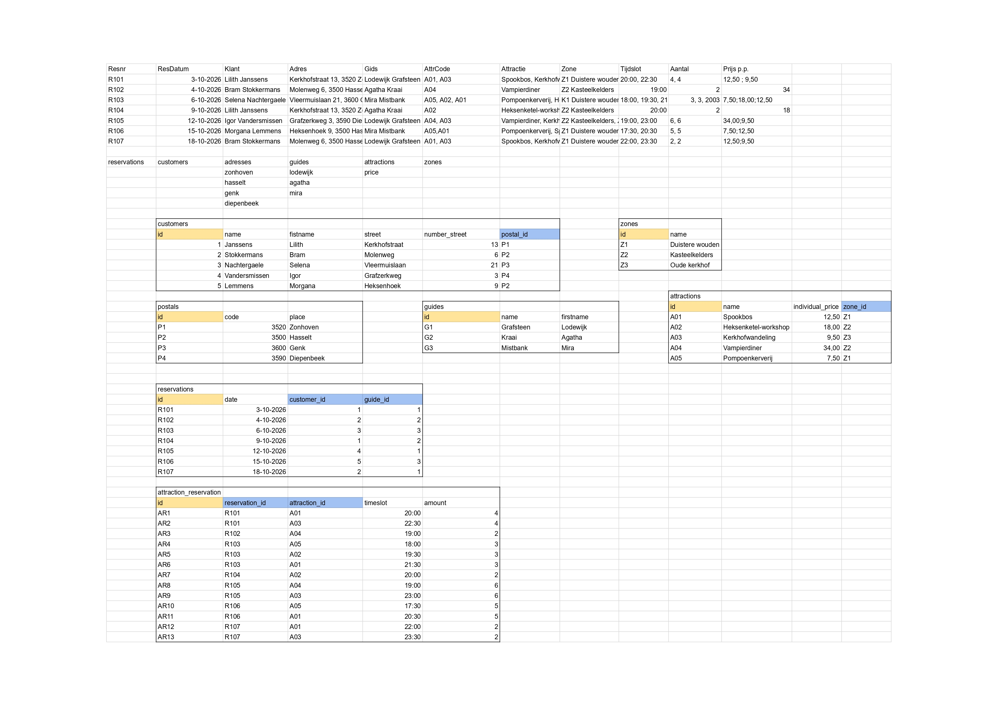

# Examen Fundamentals & tooling
26/10/2026, 12:45-16:00

## **Punten**
83 / 100

## Instructies
Los op en dien in...good luck

- Upload bij Opdrachten in Teams
    - Comprimeer de map in een .zip
    - Geef de folder de naam: familienaamVoornaam

## AI-richtlijnen
U kunt AI-hulpprogramma's gebruiken, maar u bent nog steeds verantwoordelijk voor de nauwkeurigheid en originaliteit van uw inzending.

## Referentiemateriaal

## Afgeleverde Examenonderdelen
### Halloween inschrijvingswebpagina
Volg onderstaande link om naar de webpagina te gaan!
* https://janoeszki.github.io/examen_griezelnacht/

### Normalisatie Oefening

## Examenbeleving
* Normalisatie-oefening als eerste gestart omdat webpagina het meeste tijd in beslag zou nemen
    * Tabelgegevens overtypen in Spreadsheet diende nauwkeurig te gebeuren, koste mij meer tijd dan ik wilde
    * Na een eerste review merkte ik op dat er teveel id's **dubbel** stonden in uiteindelijke Pivot-tabel.
    * Gemini Flash 3.8 om een *hint* gevraagd, deze spoorde mij aan om mijn 'reservations' tabel te herbekijken
    * Uiteindelijke 'attraction_reservation' tabel waarbij de id's mooi één keer voorkomen!

* Webpagina recreatie
    * Globale scan: Wat zie ik?
        * Navbar - Logo & Branding, subpages, knop
        * Hero - Datum- en locatiebepaling, Titel (in twee verschillende kleuren), beschrijving, Ticket & Programma buttons, extra info
            * Nacht background, Kasteel, pompoen, spook en vleermuizen images
        * Newsbrief Section - Spook image, melding, inputfield (email) en inschrijvingsknop
        * Footer - Logo, locatie, opdeling in *grid*:
            * Bezoek, Praktisch, Volg Ons

## Feedback
*"Heel erg bedankt voor je inzet Wesley, op vlak van databanken en theorie heb je echt geschitterd! Zeer zeer compleet! Voor CSS gaan we samen nog even naar je CSS-variabelen, achtergronden en Flexbox-layout kijken, want zodra dat klikt ga je ook daar grote sprongen maken! 3NF normalisatie was ook top..."*
    
**Docent SyntraPXL, De Nittis M.**